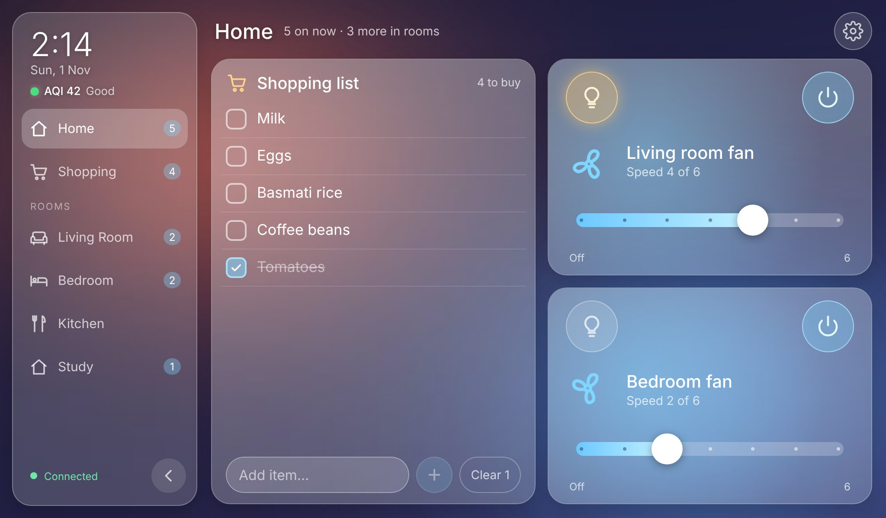
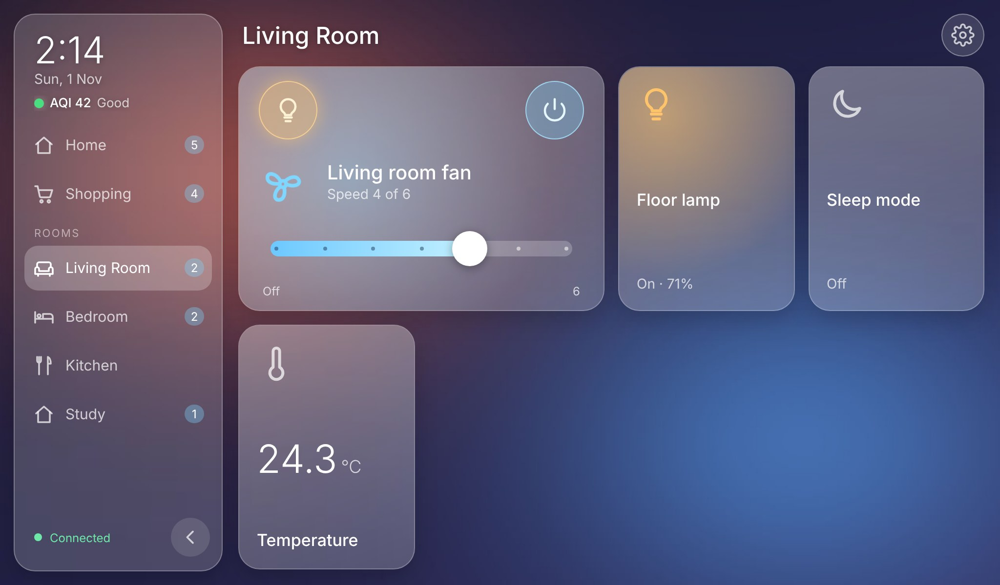
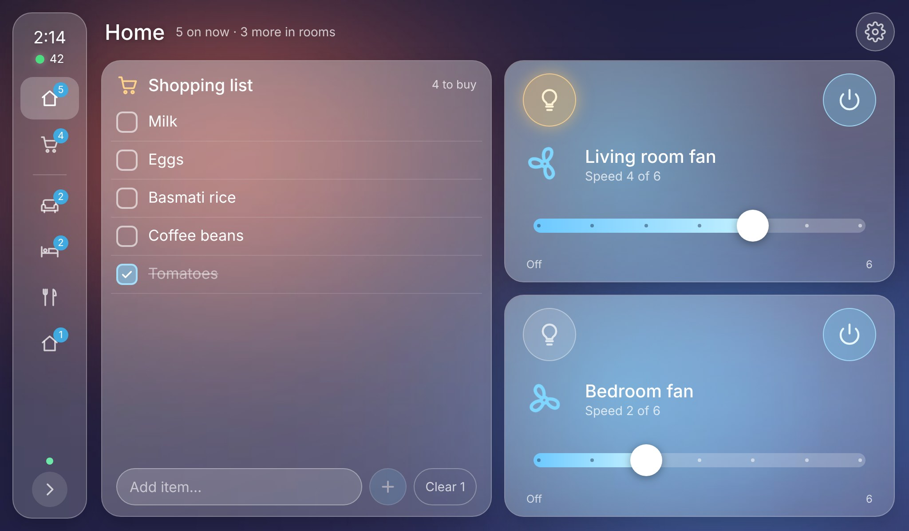
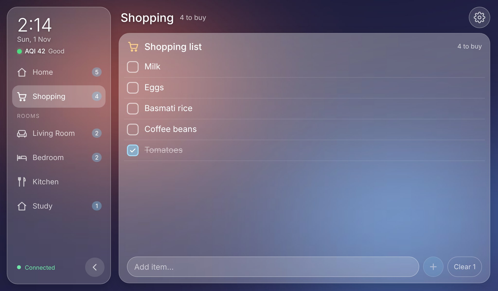
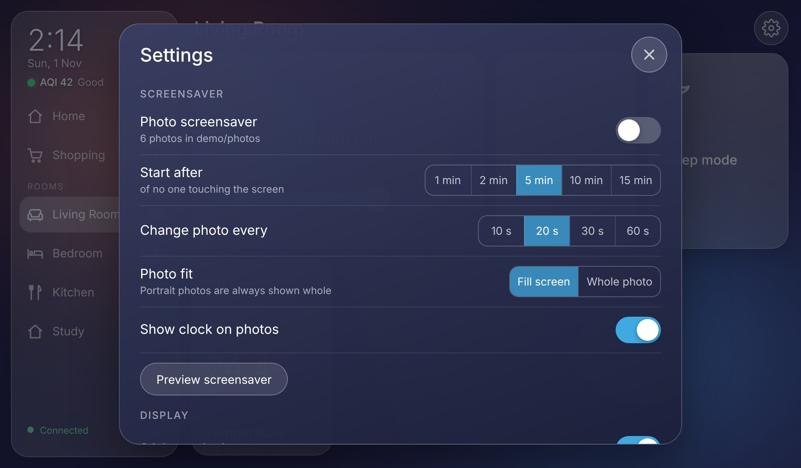
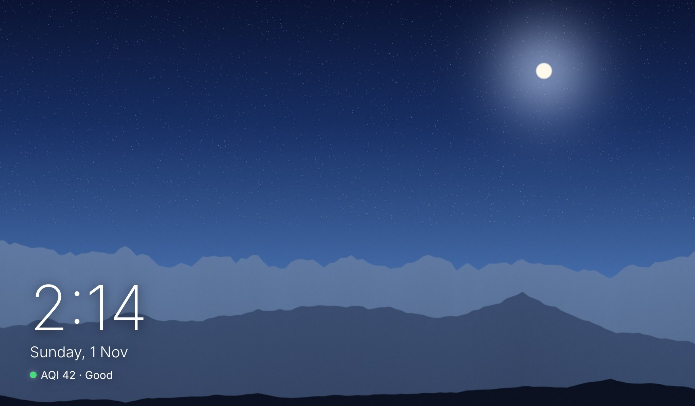
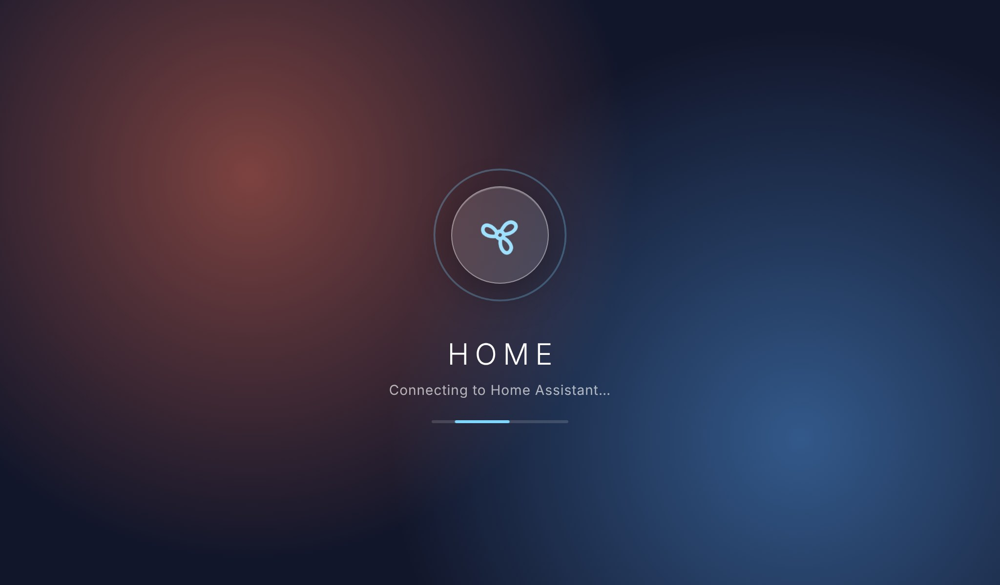

# glasspane

**A fast, good-looking Home Assistant wall dashboard for the old tablet in your drawer.**



Most Home Assistant dashboards need a modern browser. Old tablets are stuck on
old ones. Their Android can't be updated and their Chrome is years behind, so
the official frontend and most custom dashboards either crawl or show a blank
page. Those tablets would otherwise be e-waste, yet they make a great wall panel.

glasspane fixes that by moving the hard work off the tablet. A small Rust
server talks to Home Assistant, keeps the state, and pre-renders images. The
tablet gets a ~55 KB bundle built for **Chrome 57 (2017)** that only draws
tiles. It was built for a Samsung Galaxy Tab 3 Lite (Android 4.2, 1 GB RAM,
1024×600), with the server running on an old Android phone next to Home
Assistant. It works just as well in any modern browser or on a PC, Pi or NAS.

## Features

- **Rooms in a sidebar** that folds into an icon rail, with badges for how many
  devices are on.
- **Home view** shows what's on right now. When nothing is on, it shows your
  most-used devices instead, next to the shopping list.
- **Ceiling-fan tiles:**
  - a thick speed slider with the right number of steps from Home Assistant
  - a power button
  - the fan's built-in light as a button on the same tile
  - a spinning icon that turns faster at higher speeds
- **Lights, switches and sensors** as glassy tiles.
- **A shopping list** (any HA to-do list): tick items, add, clear, live-synced
  with the HA app on your phone.
- **Clock with air quality (AQI)** for your home location, from Open-Meteo
  (free, no API key).
- **Photo screensaver** after a set idle time:
  - photos are resized on the server for the exact screen, so they're sharp
    and light to load
  - a slow Ken Burns zoom
  - a clock overlay
- **Settings page** for the screensaver, clock, AQI, keep-awake and sidebar.
  Settings are saved on the server, so every screen shares them.
- **Kiosk mode:** the first tap goes full screen and keeps the screen awake,
  without needing the Wake Lock API.
- **Safe to leave on a wall:**
  - the tablet never sees your HA token
  - it can only control devices that are on the dashboard

| | | |
|---|---|---|
|  **Room** |  **Collapsed sidebar** |  **Shopping list** |
|  **Settings** |  **Photo screensaver** |  **Splash screen** |

*Screenshots are from the built-in demo home (`demo.toml`), which uses
generated landscape photos.*

## How it works

```text
┌────────────────┐  WebSocket API  ┌──────────────────────────┐  HTTP + WebSocket  ┌──────────────┐
│ Home Assistant │ ◀─────────────▶ │ glasspane server (Rust)  │ ◀────────────────▶ │ old tablet   │
└────────────────┘   token lives   │ • state cache + allowlist│   ~55 KB of JS,    │ (Chrome 57+) │
                     only here     │ • pre-blurred "glass" bg │   pre-sized images │ phones, PCs  │
                                   │ • photo resizing + cache │                    └──────────────┘
                                   │ • AQI, settings, usage   │
                                   └──────────────────────────┘
```

The tricks that make it fast on old hardware:

- **Frosted glass without `backdrop-filter`.** That CSS feature needs Chrome
  76, and the tablet has 57. The server blurs the wallpaper once. Each tile
  shows the matching slice of that pre-blurred image, so the blur costs
  nothing per frame.
- **Only `transform` and `opacity` animate**, which the GPU handles cheaply.
  The tablet never runs a layout-heavy animation.
- **The build checks itself.** esbuild targets Chrome 57, and `npm run build`
  re-parses the bundle as ES2017. It fails if any newer JavaScript API slips
  in.
- **The server does the heavy lifting**: photo resizing, the blur, JSON
  slimming (each entity sends only the fields its tile shows) and
  reconnections.

The full write-up is in **[docs/ARCHITECTURE.md](docs/ARCHITECTURE.md)**.

## Quick start

### Try the demo (no Home Assistant needed)

You need [Rust](https://rustup.rs). Node is optional, because the built
frontend is committed in `web/dist`.

```bash
git clone https://github.com/JabberWock555/glasspane && cd glasspane
cargo run --release --bin mock_ha &              # a fake Home Assistant on :8124
HA_TOKEN=dev cargo run --release -- demo.toml    # the dashboard on :8090
```

Open <http://localhost:8090>. Toggle things, drag the fan sliders and add
items to the shopping list. Then open Settings and choose **Preview
screensaver**.

### Use it with your Home Assistant

1. **Create a token.** In Home Assistant, click your profile, open
   **Security**, then **Long-lived access tokens**.
2. **Write your config.** Copy `glasspane.example.toml` to `glasspane.toml`
   and fill in your rooms and entity ids. Every option is described in
   [docs/CONFIGURATION.md](docs/CONFIGURATION.md).
3. **Run the server** next to Home Assistant, using one of these:

   **A PC, Pi or NAS (Docker):**
   ```bash
   docker build -t glasspane .
   docker run -d --name glasspane -p 8090:8090 -e HA_TOKEN=... \
     -v $PWD/glasspane.toml:/app/glasspane.toml glasspane
   ```

   **Directly:**
   ```bash
   HA_TOKEN=... cargo run --release -- glasspane.toml
   ```

   **An old Android phone (Termux):**
   ```bash
   bash scripts/install-termux.sh
   ```
   [docs/ANDROID-SETUP.md](docs/ANDROID-SETUP.md) covers the whole setup,
   including running Home Assistant itself on the phone.
4. **Open it on the tablet.** Go to `http://<server-ip>:8090` in Chrome and
   use **Add to Home screen**, which opens it full screen in landscape. Tap
   once to go full screen and keep the screen awake.

### Screensaver photos

Put JPG or PNG files in `photos_dir`. By default that's
`/sdcard/Pictures/Glasspane` on Android. Then turn the screensaver on in
Settings. The server rotates each photo upright from its EXIF data and
resizes it for each screen's exact pixel size, with high-quality resampling.
It caches the results ahead of time. Your originals are never changed.

## Hardware notes

- **Tablet:** anything with Chrome 57+ or a similar WebView. On Android 4.x,
  turn off battery saver for Chrome. Raise the screen timeout to the maximum;
  keep-awake handles the rest while the dashboard is open.
- **Server:** a single Rust binary that uses almost no CPU when idle. Memory
  peaks only while it resizes photos, which it does once per screen size
  before caching them. An old phone that already runs Home Assistant in
  Termux is plenty.
- **Remote access:** glasspane has no login of its own. Keep it on your LAN
  or a private network such as Tailscale. Don't expose it to the internet.
  See [Security](docs/ARCHITECTURE.md#security).

## Documentation

| | |
|---|---|
| [ARCHITECTURE.md](docs/ARCHITECTURE.md) | Tech stack, data flow, protocol, and how each piece is implemented and why |
| [CONFIGURATION.md](docs/CONFIGURATION.md) | Every config option and tile kind |
| [ANDROID-SETUP.md](docs/ANDROID-SETUP.md) | Turn an old phone into a Home Assistant + glasspane server (Termux, udocker, runit, Tailscale) |
| [DEVELOPMENT.md](docs/DEVELOPMENT.md) | Building, testing, the mock HA, screenshots, project layout |
| [CONTRIBUTING.md](CONTRIBUTING.md) | How to contribute |

## Roadmap ideas

- Brightness slider (long-press a light tile)
- Scenes and scripts as tap tiles
- Weather tile, plus a night mode that dims the screen after dark
- Camera snapshot tile, proxied through the server

## License

[MIT](LICENSE)
